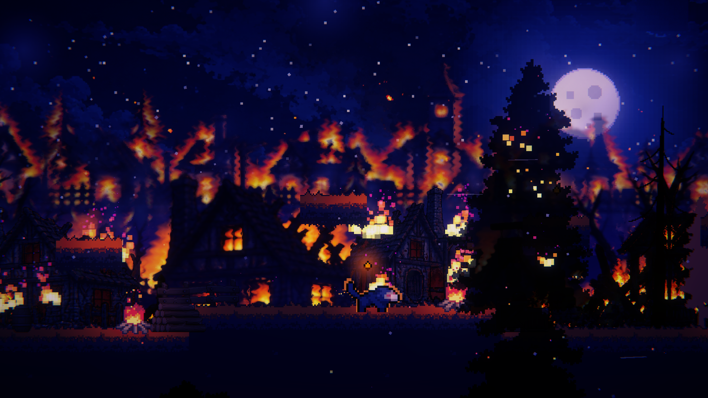
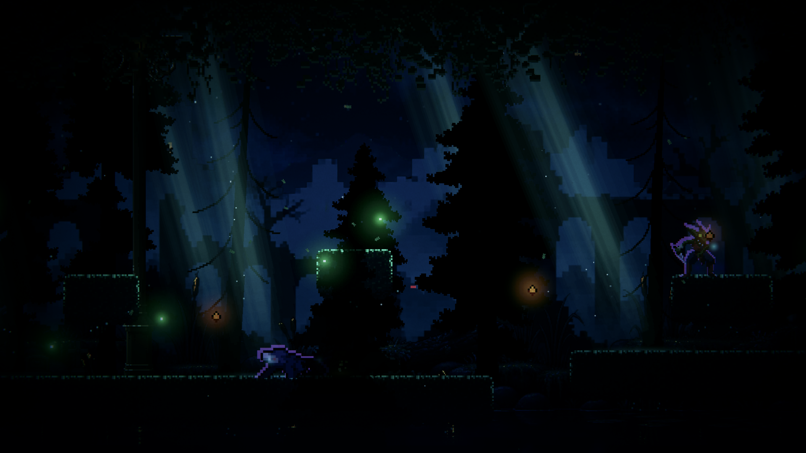
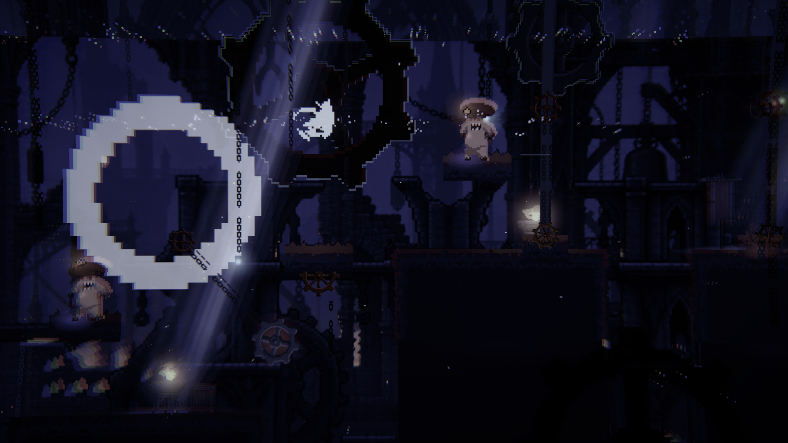

# ASHEN BOND

### Carry the light. She never left.

A dark fantasy 2D platformer about a boy, a lantern, and the sister whose shadow still protects him. Cross a burning village, enter a haunted forest, and climb toward the clock tower through fire, monsters, and broken machinery.

**Game Jam 2026 · Single player · Windows build included · Unity 6 source included**



## Play now — no Unity installation needed

1. Click **Code → Download ZIP** on GitHub and extract the downloaded archive, or clone the repository:

   ```sh
   git clone https://github.com/CsAshir/AshenBond---Game-Jam.git
   ```

2. Open **`Play/Windows`**.
3. Run **`GAME JAM - 2026.exe`**.
4. Choose **Start Game**, select a difficulty, and begin. **Easy** is a good first visit.

Keep the executable beside `UnityPlayer.dll`, `GAME JAM - 2026_Data`, and the other included runtime folders. Downloading only the `.exe` will not work. Extract the archive before launching.

The included Windows executable is the developer's final build, dated **18 October 2026, 06:38 PKT**. It was copied with its runtime files into this submission without rebuilding. Packaging was verified; a new end-to-end playtest was not performed during upload preparation.

## Two ways to experience the project

| You want to… | Use | Unity required? |
|---|---|---|
| Play the submitted Windows executable | `Play/Windows/GAME JAM - 2026.exe` | No |
| Inspect the game, scenes, and scripts | `Assets`, `Packages`, `ProjectSettings` | Yes, to open and run the project |

Both are included when you clone or download this repository. A GitHub Release download, if published, is a separate convenience download; it is not required for the clone-and-play route.

## What makes Ashen Bond tick

- **Fire, then shadow:** mark enemies with lantern fire, then call Mira's shadow strike for a three-times-damage combo.
- **A companion with a purpose:** Mira attacks, heals, and stays with Ilyan throughout the journey.
- **A second chance in time:** hold rewind to undo up to three seconds of recorded action, spending a rewind charge.
- **Platforming under pressure:** sprint, double jump, and dash through dangerous terrain.
- **Three distinct environments:** burning rooftops, moonlit woodland, and the clock tower's gears and pendulums.
- **A story between the fights:** dialogue, memories, an opening cinematic, and an ending cinematic frame the journey.

## Controls

| Action | Keyboard / mouse |
|---|---|
| Move | **A / D** or **Left / Right arrows** |
| Run | Hold **Shift** while moving |
| Jump / double jump | **Space**, **W**, or **Up arrow**; press again in the air |
| Dash | **K** or **right mouse button** |
| Lantern fire / charged flare | **J** or **left mouse**; hold to charge, release to fire |
| Mira's shadow strike | **P** |
| Heal one heart | **E**, costs **2 embers** |
| Rewind | Hold **Q** |
| Pause | **Esc** |
| Advance dialogue | **Space**, **Enter**, **J**, or **left mouse button** |
| Skip a cinematic | **Esc**, **Space**, or **Enter** |

See the in-game **How to Play** menu and the [full game guide](Docs/GAME_GUIDE.md) for combat tips and supported controller inputs.

## Hearts, chances, and game over

In the current source, Ilyan starts with **3 hearts**. Losing all hearts spends one chance. If chances remain, he returns to the checkpoint with full hearts. Losing the last chance opens **Game Over**, with **Restart** and **Give Up** options.

| Difficulty | Starting chances |
|---|---:|
| Easy | 10 |
| Medium | 5 |
| Hard | 3 |

## Explore the three environments

| Area | Atmosphere | What to watch for |
|---|---|---|
| **The Burning Village** | Fire, ash, and a village falling apart | Ember creatures, traversal hazards, and the lantern-and-shadow combo |
| **The Dark Forest** | Cold moonlight, drifting fog, and hidden shapes | Ambushes, black water, fallen-tree crossings, and the Executioner |
| **The Clock Tower** | Machinery, height, and the weight of time | Moving platforms, pendulums, gears, collapsing paths, and the Clockwork Eye |





## Open the source in Unity

1. Install **Unity Hub** and **Unity 6000.3.8f1**.
2. Clone or extract this repository.
3. In Unity Hub, choose **Add project from disk** and select the repository root — the folder containing `Assets`, `Packages`, and `ProjectSettings`.
4. Open the project and allow package restoration and the first asset import to finish. Internet is needed for missing Unity packages; the first import can take several minutes.
5. Open **`Assets/DarkForest/Scenes/MainMenu.unity`** and press **Play**.

Start from `MainMenu` for the intended cinematic and level progression. The submission copy omits the developer's optional MCP editor integration, which originally referenced a path on the developer's machine. It is not needed to play or inspect the game.

## Documentation

- [Game guide — story, systems, controls, progression, and troubleshooting](Docs/GAME_GUIDE.md)
- [Judge quick start — download, clone, play, and source review](Docs/JUDGE_QUICK_START.md)
- [Credits and asset acknowledgements](Docs/CREDITS.md)
- [Dialogue script and voice direction](Docs/Dialogue_Script.md) — contains story spoilers and production notes.

## Team

| Contributor | Role |
|---|---|
| **Muhammad Ashir** | Game design and development: gameplay programming, level design, combat, lighting, VFX, and art direction |
| **Sarah Khan** | Asset research and level design: environments, enemies, props, audio sourcing, and map creation |
| **Javeria Ismail** | AI-generated assets and cinematic production: artwork, cutscenes, cinematic shots, and visual production |

See [Credits](Docs/CREDITS.md) for third-party acknowledgements. This repository does not grant a blanket reuse license for third-party assets.

